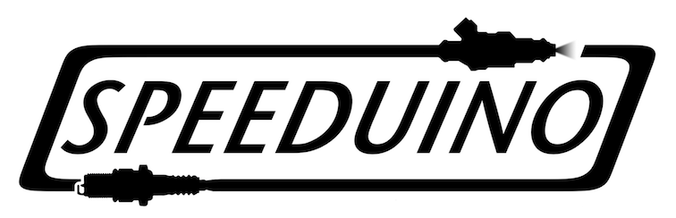

# RYN Speeduino Configurator 🏎️⚡

[](https://opensource.org/licenses/MIT)


**RYN Speeduino Configurator** is a modern, high-performance desktop application designed for tuning Speeduino ECUs (Engine Control Units). Built with Electron and React, it offers a sleek, professional interface with real-time telemetry, 3D visualizations, and robust ECU synchronization.



## ✨ Key Features

- 🚀 **Real-time Tuning**: Instant ECU synchronization with modern protocol support (CRC32 protection).
- 📊 **Dynamic Dashboard**: High-frequency telemetry updates (10Hz+) for critical engine parameters.
- 🧊 **3D Visualization**: Visualize tuning tables (VE, Ignition, AFR) in 3D using React Three Fiber.
- 📂 **Universal INI Support**: Flexible metadata parsing with embedded INI portability—open your projects anywhere.
- 🎨 **Modern UI**: Restrained neon accents on a professional acrylic surface for a premium automotive feel.
- 🛠️ **Smart Sync**: Bidirectional synchronization between ECU RAM, EEPROM (Burn), and local project files.

## 📸 Screenshots

*(Add your screenshots to the `/screenshots` folder and link them here)*

| Dashboard | 3D Table Editor |
| :--- | :--- |
|  |  |

## 🛠️ Technology Stack

- **Core**: Electron, Node.js
- **Frontend**: React 19, TailwindCSS, Framer Motion
- **State Management**: Zustand (Multi-slice architecture)
- **Visualization**: Three.js (React Three Fiber), uPlot
- **Hardware Communication**: Node-SerialPort (Modern CRC32 Protocol)

## 🚀 Getting Started

### Prerequisites

- [Node.js](https://nodejs.org/) (Version 20 or later recommended)
- [npm](https://www.npmjs.com/)

### Installation

1. **Clone the repository:**
   ```bash
   git clone https://github.com/sigitlutfi/ryn-speeduino-configurator.git
   cd ryn-speeduino-configurator
   ```

2. **Install dependencies:**
   ```bash
   npm install
   ```

3. **Start the application:**
   ```bash
   npm start
   ```

### Hardware Connection

Connect your Speeduino ECU via USB. The application will automatically attempt to detect common serial ports. For development without hardware, the app includes a **Mock Serial** mode.

## 🤝 Contributing

We welcome contributions from the community! Whether it's reporting bugs, suggesting features, or submitting pull requests, your help is appreciated.

Please check out our [CONTRIBUTING.md](CONTRIBUTING.md) for more details.

## ⚖️ License

Distributed under the **MIT License**. See `LICENSE` for more information.

## 📧 Contact

**Sigit Lutfy** - [sigitlutfy@gmail.com](mailto:sigitlutfy@gmail.com)

Project Link: [https://github.com/sigitlutfi/ryn-speeduino-configurator](https://github.com/sigitlutfi/ryn-speeduino-configurator)

---

## ⚖️ Disclaimer

**Speeduino** is a trademark of its respective owners. This project is an independent open-source tool and is not officially affiliated with, endorsed by, or connected to the official Speeduino project or its creators. Use this software at your own risk. Digital tuning can cause engine damage if not handled correctly.

---
*Built with ❤️ for the Speeduino Community.*
