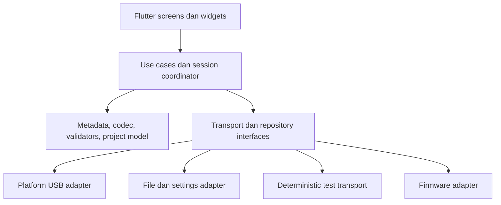

# 02 — Arsitektur Flutter

Ini **usulan port**, bukan implementasi Flutter yang sudah ada. Tim boleh memilih state-management sendiri. Domain dan transport harus dapat diuji tanpa widget/platform.



## Pemetaan tanggung jawab

| Desktop | Flutter |
| --- | --- |
| `src/shared` | Pure Dart codec, metadata, validator dan formatter |
| Store slices | Application services dan state/domain reducers |
| `serialService` | Satu protocol coordinator dan command-response queue |
| Main process serial queue | Pemilik native handle pada adapter platform |
| `preload.js` | Referensi capabilities platform, bukan API yang harus disalin literal |
| React hooks | Form/table controller yang memakai use case domain |
| UI components | Flutter views dengan layout sentuh |

Struktur yang dapat dipakai: `domain/{protocol,ini,project,validation}`, `application/{connection,sync,tuning,calibration}`, `infrastructure/{serial,files,firmware,mock}`, `presentation/{projects,dashboard,tuning,tools}`.

## Model state

- **Project:** document/raw pages, decoded cache, field/table drafts, dirty fingerprint, restore points, file reference/revision, `projectEpoch`.
- **Connection:** status, device, baud, session ID, signature, transport/handshake/validation status, error/event log, retry pause, intent generation dan active attempt lease.
- **Operation:** type, stage, label, progress, scope, owner unik. Progress update mempertahankan owner.
- **Realtime:** canonical nullable sample, received-at, source session/epoch, error, packet-rate window, recording dan provenance.
- **Preferences:** app settings/dashboard; unit tuning tersimpan pada project.
- **Runtime:** Drive Mode hasil ECU; legacy profile overlay dipisahkan dari document project.

State ephemeral seperti mode aktif, koneksi dan RAM overlay tidak dipulihkan dari file sebagai fakta ECU.

## Interface transport konseptual

```dart
// Konseptual; type/import disediakan implementasi adapter tim.
abstract interface class EcuTransport {
  Future<List<DeviceDescriptor>> enumerate();
  Future<void> open(DeviceDescriptor device, int baud);
  Future<void> close();
  Future<void> writeBytes(Uint8List bytes); // write/drain selesai
  Future<void> flushInput();
  Future<void> setControlLines({required bool dtr, required bool rts});
  Stream<Uint8List> get receivedBytes; // potongan arbitrer
  Stream<TransportEvent> get events;
}
```

Pisahkan optional capabilities seperti `canSetControlLines`, `canFlash` dan `canResetEeprom`. Tombol hanya tersedia bila adapter mendukungnya. Paket ini belum memilih plugin serial.

## Ownership wajib

Ada dua antrean: transaksi protokol sampai respons selesai, dan operasi native open/close/write/drain/reset/flash. Mutex TX saja tidak cukup; command berikutnya menunggu seluruh respons sebelumnya.

Satu connect attempt memiliki lease. Manual intent dapat membatalkan lease lama. Setelah setiap `await`, periksa epoch, session/generation, INI yang dipakai dan owner. `finally` hanya melepas miliknya. Cleanup sesi lama tidak boleh mengurangi polling suspension sesi baru.

Token/generation boleh direpresentasikan berbeda dari JavaScript asalkan semantiknya sama. `mounted` widget bukan satu-satunya cancellation: service harus membatalkan request, timer dan stream listener juga.

## Batas UI

Widget mengirim intent seperti `saveScope`, `compare`, `burnPages`, `selectDriveMode`. Widget tidak menyusun frame atau membaca USB langsung. Draft lintas tab harus terdeteksi pada global Save/close project. Semua halaman memakai registry unit/kualitas telemetry yang sama.

Rujukan: [store](../src/renderer/core/store/index.js), [recovery](../src/renderer/core/services/ecuRecovery.js), [native lifecycle](../src/main/serial-lifecycle.js), [connection state](../src/renderer/core/store/connectionSlice.js).
