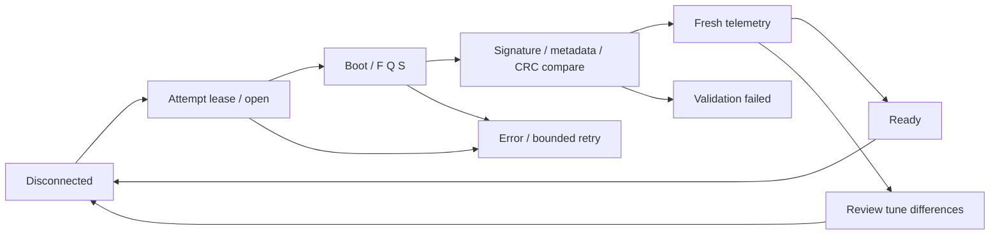

# 07 — Koneksi, sync, recovery dan concurrency

## State yang berbeda

| State | Nilai/peran |
| --- | --- |
| Connection | disconnected, connecting, connected, disconnecting, error |
| Transport | Status handle USB/serial |
| Handshake | idle, probing, ok, failed |
| Validation | idle, checking, ready, review, failed |
| Page sync | Bookkeeping bytes project vs RAM/Burn; dokumen 04 |
| Operation | Owner/type/stage/progress; satu operasi ECU aktif |

Serial-open tidak sama dengan handshake sukses, dan handshake tidak sama dengan tune/telemetry valid.

## Session ownership

Track native connect generation, protocol session generation, user-intent generation, active attempt lease, project epoch dan INI identity. Setelah setiap await, hasil hanya boleh diterapkan pada context yang masih sama.

Manual/auto/post-reset recovery memakai lease yang sama. Manual intent dapat membatalkan attempt lama. Late enumeration, old Disconnect ACK atau old finally tidak boleh menutup/melepas attempt pengganti. Duplicate connected event tidak memulai handshake kedua; native event `connecting` menandai replacement session. Callback data/close port generasi lama diabaikan.

Pada disconnect/error: retire parser requests/listeners, hentikan polling, clear received-at/rate/Drive Mode status, stop recording dan invalidate runtime assumptions. Jangan menampilkan sample terakhir sebagai LIVE.

## Polling

Baseline interval **120 ms**; rate yang ditampilkan merupakan pengamatan packet arrivals, bukan angka timer. Poll hanya setelah signature/INI, compare dan fresh telemetry lolos. Validation `review` mengizinkan telemetry, tetapi UI tetap meminta review perbedaan tune.

Exclusive operation suspend polling dan menunggu read aktif selesai; desktop timeout drain 1500 ms. Menghentikan timer tidak berarti respons di wire sudah selesai. Bedakan read owner dari poll generation: old read tetap membersihkan busy flag miliknya setelah selesai, tetapi tidak mempublikasikan sample bila poll/session berubah.

Resume hanya berlaku pada session asal. Cleanup operasi lama tidak boleh menurunkan suspension counter pada session baru. Reset membatalkan active/queued transactions. Semua operasi melepas **owner sendiri**, termasuk setelah progress update.

## Compare

1. Validasi contract dan active pages; reject invalid page IDs/size.
2. Validasi local complete snapshot. Missing local page dilaporkan, bukan diisi nol lalu di-upload.
3. Baca ECU page CRC. Jika berbeda, baca page lengkap (64-byte chunks), verifikasi CRC readback; gunakan bytes untuk membedakan perbedaan nyata.
4. Laporkan matching/different/generated/missing/errors dan page diffs: CRC, offset/length, preview bytes.
5. Hasil hanya di-commit bila project, INI, session, raw target dan draft context tetap sesuai.

Mismatch bukan izin write. Tidak ada upload/download otomatis sebagai efek popup.

## Write RAM dan Burn

Sebelum write: resolve scope, validasi seluruh local snapshots, range/ownership/hardware policy dan Drive Mode DEFAULT pada firmware paired. Hitung modified region pada complete base buffers; jangan memusnahkan reserved bytes. Persist restart-required dahulu bila field hardware relevan berubah.

Write plan menandai pending sebelum pengiriman. Tulis RAM, baca kembali dan cocokkan bytes/CRC. RAM-only sukses menghasilkan Burn pending. Kegagalan/lost ACK tetap dilaporkan dan diverifikasi, bukan dianggap tidak ada perubahan.

Burn standalone juga harus membuktikan RAM sesuai target. Kirim `b`, terima ACK, poll `burnPending` hingga 0/false (deadline 15 detik), lalu readback/CRC verify. ACK saja tidak cukup. Failure menjaga state unverified; jangan menawarkan klaim EEPROM aman.

Download ECU membangun snapshot lengkap dan decoded/display cache baru setelah seluruh context/reads valid. Download belum menyimpan file otomatis; Save tetap diperlukan.

## Recovery dan reset

Post-reset/flash recovery mencoba sampai 5 kali dengan backoff 0.5/1/2/4 detik antarattempt; menunggu port muncul dan handshake/validation dengan deadline 45 detik per open attempt. CRC/contract failure tidak disembuhkan dengan terus membuka port: tampilkan error/review.

Background auto reconnect: maksimum 8 attempts, backoff sampai 8 detik, hanya bila preference aktif, device diingat, tidak paused, tidak ada operation/attempt lain, dan status disconnected/error. Manual Disconnect tetap disconnected; manual Connect mengaktifkan kembali recovery. Sesi sukses me-rearm retry untuk putus berikutnya.

USB reset: fresh RPM=0 dan running/cranking=false; burnPending=0; testenabled/testactive=0. Unknown menolak reset. Pending RAM/Burn ditolak. Reserve native operation **sebelum await**, validasi selected port sama dengan active physical handle, pulse DTR/RTS, close handle, lalu recovery. Flash/EEPROM-reset juga reserve sebelum port close/avrdude startup.

USB reset mengirim control-line pulse, bukan memutus supply ECU. Hardware restart-required banner tidak otomatis hilang. Physical power cycle tetap membutuhkan konfirmasi user dan verifikasi target pada koneksi baru.

## Race regression wajib

Auto enumerate → manual connect; disconnect ACK → connect baru; duplicate connected; boot delay → cancel; old poll reply → new session; suspend/resume saat read; old sync finally → operation baru; setting/project berubah saat await; CRC failed → operasi lain mencoba mempublikasikan telemetry. Hasil lama harus dibuang dan owner baru tetap utuh.

Rujukan: [recovery](../src/renderer/core/services/ecuRecovery.js), [sync](../src/renderer/core/store/slices/ecu.sync.js), [App coordinator](../src/renderer/App.jsx), [native serial](../src/main/index.js), [race tests](../test/ecu-recovery.test.mjs), [acceptance](12_DELIVERY_AND_ACCEPTANCE.md).
